<div align="center">
  
  <h1>KAGE</h1>
  <p><strong>A self-hosted anime browsing and streaming interface.</strong></p>
  <p>Search anime, explore episodes, choose sub or dub servers, and play HLS streams from a clean dark-themed web UI.</p>

  <p>
    
    
    
  </p>
</div>

<p align="center">
  
</p>

> **Important:** KAGE accesses third-party services and displays streams supplied by
> those services. Make sure your use complies with the laws and terms that apply
> to you. KAGE does not host or own the streamed content.

## What is KAGE?

KAGE is a small self-hosted application made of two services:

- **Frontend** — a Flask server that serves the browser UI and proxies HLS and subtitle requests.
- **API** — a FastAPI service that retrieves anime metadata, episode information, streaming servers, subtitles, and stream URLs.

The API uses Node.js to run the stream decryption helper required by the upstream
stream provider. The frontend and API are intentionally separate, so the API can
run on another machine if desired.

```text
┌──────────────┐       ┌──────────────────────┐       ┌─────────────────────┐
│    Browser   │──────▶│  Frontend · :6767    │──────▶│  API · :8787         │
│  app.html    │       │  app.py              │       │  KAGE_API/reanime.py │
└──────────────┘       └──────────────────────┘       └──────────┬──────────┘
                                                                  │
                                                                  ▼
                                                        Third-party providers
```

## Features

- Search anime and browse current, popular, and top titles
- View anime details, episode lists, recommendations, and weekly schedules
- Select available subbed and dubbed servers
- Play HLS streams through the built-in browser proxy
- Display subtitles, episode thumbnails, and intro/outro chapter metadata
- Responsive dark-themed interface
- Installable PWA with browser, Android, Apple, and Windows icon assets
- Interactive API documentation through Swagger UI and ReDoc

## Requirements

- Windows
- Python **3.11 or newer**
- Node.js **20 or newer**
- Internet access

The frontend requires Flask and `curl-cffi`. The API requires FastAPI,
Uvicorn, `curl-cffi`, `httpx`, and PyCryptodome.

## Quick start

### 1. Start the API

Open a Command Prompt or PowerShell window in the project directory and run:

```bat
api.bat
```

The API starts at <http://localhost:8787>.

### 2. Start the frontend

Open a second Command Prompt or PowerShell window in the same directory and run:

```bat
app.bat
```

The frontend starts at <http://localhost:6767>.

### 3. Open KAGE

Visit <http://localhost:6767> in your browser. Keep both terminal windows open
while using the app.

The batch files check for Python and Node.js, then install the service-specific
Python dependencies when needed.

## Manual setup

Install the dependencies from the project root:

```powershell
python -m pip install flask curl-cffi fastapi "uvicorn[standard]" "httpx[http2]" pycryptodome
```

Start the API from a terminal:

```powershell
Set-Location .\KAGE_API
python reanime.py
```

In a second terminal, start the frontend from the project root:

```powershell
python app.py
```

The default service addresses are:

| Service | URL | Entry point |
| --- | --- | --- |
| Frontend | <http://localhost:6767> | [`app.py`](app.py) |
| API | <http://localhost:8787> | [`KAGE_API/reanime.py`](KAGE_API/reanime.py) |
| API docs | <http://localhost:8787/docs> | FastAPI Swagger UI |
| Alternative docs | <http://localhost:8787/redoc> | FastAPI ReDoc |

Press `Ctrl+C` in each terminal to stop a service.

## Configuration

The frontend reads the API address from [`_KEY.txt`](_KEY.txt):

```text
BASE_API_URL=http://localhost:8787
```

To use an API running on another machine or port:

1. Set `BASE_API_URL` to the API’s reachable address.
2. Restart `app.py` or `app.bat`.
3. Open the frontend using the address of the machine running `app.py`.

`app.py` generates [`config.js`](config.js) dynamically from `_KEY.txt`.
For local development, keep the default value:
`http://localhost:8787`.

Both services bind to `0.0.0.0` by default. If the app is reachable from a
network, protect it with your firewall or place it behind an authenticated
reverse proxy.

## API endpoints

The API is available at the configured `BASE_API_URL`:

| Method | Endpoint | Purpose |
| --- | --- | --- |
| `GET` | `/search?q=...&limit=20` | Search anime |
| `GET` | `/home?limit=20` | Latest anime and weekly picks |
| `GET` | `/top?period=week&limit=20` | Top anime by period |
| `GET` | `/schedule` | Weekly airing schedule |
| `GET` | `/info/{slug}` | Anime metadata and episodes |
| `GET` | `/episodes/{slug}` | Episode list |
| `GET` | `/servers/{slug}/{episode}` | Available sub/dub servers |
| `GET` | `/stream/{access_id}?v=2` | Resolve a stream |
| `GET` | `/stream/from-link?link={url}` | Resolve a full stream link |
| `GET` | `/thumbnails/{anilist_id}` | Episode thumbnail data |
| `GET` | `/recommendations/{slug}` | Related anime |

### Typical playback flow

```text
1. GET /search?q=demon+slayer
   └─ choose an anime slug

2. GET /servers/{slug}/{episode}
   └─ choose a sub or dub dataLink

3. GET /stream/from-link?link={dataLink}
   └─ receive the HLS URL, subtitles, thumbnails, and chapters
```

Stream tokens are one-time-use and returned stream URLs are temporary. Avoid
caching `/stream` responses or reusing an old stream URL.

## Project structure

```text
KAGE/
├── app.html                 # Browser UI
├── app.py                   # Flask frontend, config endpoint, and media proxy
├── app.bat                  # Windows frontend launcher
├── api.bat                  # Windows API launcher
├── _KEY.txt                 # Frontend-to-API URL configuration
├── config.js                # Default client-side configuration
├── site.webmanifest         # PWA metadata
├── KAGE_FLOW.svg            # Frontend/API connection diagram
├── favicons/                # Browser, mobile, and Windows icon assets
└── KAGE_API/
    ├── reanime.py           # FastAPI API and upstream integrations
    ├── decrypt.mjs          # Node.js stream decryption helper
    └── README.md             # API-specific documentation
```

## Troubleshooting

### The page cannot connect to the API

Confirm that `api.bat` is running and that [`_KEY.txt`](_KEY.txt) points to the
same host and port. Test the API directly at <http://localhost:8787/docs>.

### Python or Node.js is not found

Install Python 3.11+ and Node.js 20+, then make sure both commands are on your
`PATH`:

```powershell
python --version
node --version
```

Restart the terminal after changing `PATH`.

### Stream resolution or playback fails

Stream tokens and URLs supplied by upstream services can be short-lived or
single-use. Retry from the episode page instead of reusing an old URL. Upstream
availability, rate limits, or provider changes can also prevent playback.

### A port is already in use

Stop the process using port `6767` or `8787`, or update the launch configuration
and the corresponding `BASE_API_URL` value consistently.

## Development notes

- [`app.py`](app.py) serves the UI and proxies HLS and subtitle requests.
- [`KAGE_API/reanime.py`](KAGE_API/reanime.py) exposes metadata and stream APIs.
- [`KAGE_API/decrypt.mjs`](KAGE_API/decrypt.mjs) handles the upstream decryption flow.
- Do not commit private API keys, cookies, or other credentials.
- See [`KAGE_API/README.md`](KAGE_API/README.md) for API internals and the decryption flow.

## License

No license file is currently included. Add a license before distributing or
reusing this project publicly.
